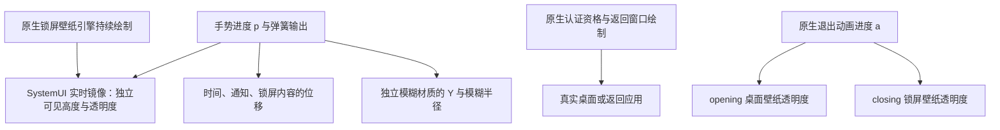

# Flyme 12 锁屏图层、壁纸交接与当前移植错误

2026-10-03。重新分析项目内 Flyme 12.6.0.0A 的 SystemUI、services.jar 与既有 framework 证据。本文记录原包行为和适配差异，不代表新的合成路径已经通过 myron 真机验收。

## 结论

用户描述的分层方向成立：锁屏内容、模糊材质、锁屏壁纸显示副本和真正返回的场景具有不同的变换所有者。不能把原始锁屏壁纸引擎当成整页内容一起向上搬，也不能只在它下面再放一张桌面图片。

原包确实会裁切和淡出锁屏壁纸，但对象是 **SystemUI 中的实时镜像**，不是正在绘制的原始壁纸节点。原始引擎负责持续产出内容。框架能使这个节点脱离显示树，让镜像继续显示；真正桌面壁纸和返回应用由各自原生窗口提供。另有退出动画控制锁屏和桌面壁纸的透明度。手势展开进度与退出动画进度不能互相替代。

0.2.2 将镜像的裁切、淡出参数直接应用到原始锁屏 leash；它没有建立这组分工。同时，返回 Activity 尚未从 STOPPED 进入 STARTED，真实返回画面没有绘制。两个问题需要分别修正。

## 原包身份

| 文件 | SHA-256 |
|---|---|
| SystemUI.apk | `25f06641281866e69d10e215f34d4aa715f9f79387489784397a71ae3da1ab5c` |
| services.jar | `3a846162aa5453b554428fef627b2ebd5d35a8235987b36b95cc49274b01f609` |
| framework.jar | `7fe7da4b0e75095e4e5c9ae69133f794a06ee7c4e455c21c3fc7261290f7d55a` |

以下路径均为本机原包拆解证据，没有将厂商 APK/JAR 加入模块发行包。

## 布局与驱动分工

原布局 [lockscreen_wallpaper_content.xml](C:/Users/ZhuanZ/Desktop/Flyme/analysis/decompiled/SystemUI/resources/res/layout/lockscreen_wallpaper_content.xml:7) 包含 SurfaceView `lock_wallpaper_mirror`、独立 View `wallpaper_blur_bg`、海报装饰和 `wallpaper_foreground_shade`。上层锁屏内容与通知容器在 [super_notification_shade.xml](C:/Users/ZhuanZ/Desktop/Flyme/analysis/decompiled/SystemUI/resources/res/layout/super_notification_shade.xml:72) 单独声明。

这表示职责关系，不是未经测量的 SurfaceFlinger 最终 Z 排序。SurfaceView 子层和 BackgroundBlurDrawable 的 ZAdjustment 也参与最终排序；原包对镜像 View 的背景设置过 `-1` 的 ZAdjustment。

设 `p=1` 为完整锁屏、`p=0` 为收起，H 为显示高度：

| 驱动对象 | 原包普通可划走分支 | 所有权 |
|---|---|---|
| 锁屏内容 | `Y=-H(1-p)+springHeight`；需要认证时主位移 `/8` | 内容根与内容 ViewModel |
| 模糊材质 | `Y=Hp-H`；可见高度 `Hp` | 独立 `wallpaper_blur_bg` |
| 锁屏壁纸镜像 | 镜像 View 高度 `int(Hp)`；零高度回退为 1 | SystemUI 镜像显示层 |
| 镜像透明度 | 普通样式 `clamp((p-.02)/.78)` | 镜像 Surface 的 alpha |
| 原始壁纸引擎 | 生命周期、绘制、原生坐标及当前封面 | 原生壁纸进程与框架 |

内容位移来自 [KeyguardInteractor 的 keyguardTranslationY](C:/Users/ZhuanZ/Desktop/Flyme/analysis/decompiled/SystemUI/sources/com/android/systemui/keyguard/domain/interactor/KeyguardInteractor$keyguardTranslationY$1.java:52)。模糊 Y 计算与写入分别见 [calculateWallpaperBlurBgY](C:/Users/ZhuanZ/Desktop/Flyme/analysis/decompiled/SystemUI/sources/com/flyme/systemui/wallpaper/LockscreenWallpaperManager.java:1303)、[setWallpaperBlurBgY](C:/Users/ZhuanZ/Desktop/Flyme/analysis/decompiled/SystemUI/sources/com/flyme/systemui/wallpaper/LockscreenWallpaperManager.java:1945)。支持原生面板模糊时移动 View 的 Y；兼容分支改 clipBounds，不是移动壁纸本身。

原生模糊半径在 p 从 1 到 .7 时由 0 增至 80。sticky、QS、新时钟样式以及 p<=0 等分支不启用这一普通面板模糊路径。不能把原始半径 80 直接等同于澎湃半径 80；移植仍须使用澎湃的能力判断、半径换算和材质实现。

## 实时镜像与原始引擎的关系

原框架 [WallpaperController.getLockWallpaperSurfaceRoot](C:/Users/ZhuanZ/Desktop/Flyme/analysis/evidence/WallpaperController.java:972) 选择锁屏壁纸，并镜像其父节点 `SurfaceControl.mirrorSurface(parent.getSurfaceControl())`。没有锁屏专用引擎时有原生可见壁纸回退。SystemUI [mirrorWallpaper](C:/Users/ZhuanZ/Desktop/Flyme/analysis/decompiled/SystemUI/sources/com/flyme/systemui/wallpaper/LockscreenWallpaperManager.java:1504) 将返回镜像挂到自身 SurfaceView 下。

镜像 alpha 写入见 [1906 行](C:/Users/ZhuanZ/Desktop/Flyme/analysis/decompiled/SystemUI/sources/com/flyme/systemui/wallpaper/LockscreenWallpaperManager.java:1906)，镜像高度见 [1924 行](C:/Users/ZhuanZ/Desktop/Flyme/analysis/decompiled/SystemUI/sources/com/flyme/systemui/wallpaper/LockscreenWallpaperManager.java:1924)。这些方法没有把镜像透明度写回原始壁纸引擎。

框架 [updateWallpaperTokens](C:/Users/ZhuanZ/Desktop/Flyme/analysis/evidence/WallpaperController.java:692) 在原生条件允许时同时保持桌面与锁屏 token 绘制，并调用锁屏 token 的 `attachToDisplay(false)`。其 [具体实现](C:/Users/ZhuanZ/Desktop/Flyme/analysis/evidence/FlymeWallpaperWindowToken.java:260) 是将原始 token Surface reparent 到 null，而不通过 hide 停止它。重新接回时使用当前原生父节点。

触发条件不是任意手势：要同时满足选择桌面壁纸、目标强制保留锁屏壁纸、非 goingAway、相关 token 不处于 transition 等原生检查。`forceShowLockWallpaper` 要求 keyguard host window 和 Flyme 的 `meizuFlags & 4194304`，见 [FlymeWindowState](C:/Users/ZhuanZ/Desktop/Flyme/analysis/evidence/FlymeWindowState.java:4393)。SystemUI [applyKeyguardFlags](C:/Users/ZhuanZ/Desktop/Flyme/analysis/decompiled/SystemUI/sources/com/android/systemui/shade/NotificationShadeWindowControllerImpl.java:322) 负责这个标志。澎湃没有这一套 Meizu 标志语义，不能仅照抄整数。

`mirrorWallpaper` 的常规 JADX 输出存在协程控制流错误；本结论交叉核对了 [fallback 指令输出](C:/Users/ZhuanZ/Desktop/Flyme/analysis/evidence/LockscreenWallpaperManager-fallback.java:2525)。Flyme WindowState 的单类反编译整体返回 1，有其他方法无法完整重建；这里使用的是可读的独立小方法，不把整文件视为已无误反编译。

Android [SurfaceControl 文档中的镜像示意](https://android.googlesource.com/platform/frameworks/base.git/+/master/core/java/android/view/SurfaceControl.java) 同样将返回值定义为镜像层级的父节点。接口存在只能确认 API，不能证明厂商合成、截图、节点脱开和帧更新行为。

## 接近退出时的桌面壁纸变化

有两个不同阶段和多个样式分支：

1. 拖动阶段，普通样式的镜像随 p 淡出；新时钟样式把任何非零 alpha 提升为 1，到 p<=.02 才变为 0。高度变化仍由独立镜像高度流驱动。见 [calculateWallpaperAlpha](C:/Users/ZhuanZ/Desktop/Flyme/analysis/decompiled/SystemUI/sources/com/flyme/systemui/wallpaper/LockscreenWallpaperManager.java:1278)。新样式条件来自时钟 style 配置非零，不能因布局看起来相似就猜测为普通样式。
2. 原生退出阶段，`KeyguardUnlockAnimationController` 分别收到 `openingWallpaperTargets` 和 `closingWallpaperTargets`，不是把一張桌面图贴在锁屏下方。目标接入见 [414 行](C:/Users/ZhuanZ/Desktop/Flyme/analysis/decompiled/SystemUI/sources/com/android/systemui/keyguard/KeyguardUnlockAnimationController.java:414)，分别写 alpha 见 [758 行](C:/Users/ZhuanZ/Desktop/Flyme/analysis/decompiled/SystemUI/sources/com/android/systemui/keyguard/KeyguardUnlockAnimationController.java:758)。

其中一条动画路径让 opening 壁纸淡入 300ms，closing 壁纸延迟 150ms 后淡出 150ms。另一条 `setSurfaceBehindAppearAmount(a, true)` 路径按动画 a 计算：opening 为 `max(0,(a-25/325)/(1-25/325))`，closing 为 `1-clamp((a-150/325)/(150/325))`。这里的 a 是退出动画进度，**不能直接设为 1-p**。普通滑动的 `updateSurfaceBehindAppearAmount` 又直接使用 a=1；桌面、应用、快速甩动、生物认证和 canned 动画分别走不同分支。

因此，目前能确认“独立镜像/模糊层 + 真实底层窗口 + 独立壁纸退出交接”，不能确认所有主题在手指上滑最后固定百分比执行同一条渐变。用户观察到的具体视觉需要匹配时钟样式、原生远程动画目标和退出分支。

## 真实应用为何没有透出

Flyme 在启用其原生 swipe unlock 分支时，dismissAmount>0 就调用 [showSurfaceBehindKeyguard](C:/Users/ZhuanZ/Desktop/Flyme/analysis/decompiled/SystemUI/sources/com/android/systemui/keyguard/KeyguardUnlockAnimationController.java:549)，由 [KeyguardViewMediator](C:/Users/ZhuanZ/Desktop/Flyme/analysis/decompiled/SystemUI/sources/com/android/systemui/keyguard/KeyguardViewMediator.java:2976) 请求原生 keyguard transition/goingAway；回弹撤销相应状态。它有实际返回窗口和远程动画 leash。

现有移植在 myron 的实际失败回执为：返回 APP 已 clientVisible/visibleRequested，Activity 仍 STOPPED，窗口 GONE，drawn=false；桌面和锁屏引擎均已 EGL swap。原生 `makeActiveIfNeeded` 先尝试 resume，被仍保留的锁屏休眠阻止后直接返回，没有执行后续 START。场景绘制不成立，再正确的壁纸渐变也不能露出实时应用。

当前源码中已准备限定于已认证返回目标的 `shouldResumeActivity=false` 适配，让原生流程进入 `shouldStartActivity`。goingAway 时停止抑制，交回正式 resume。它尚未在真机加载、证明 STARTED 和窗口绘制，不能计为已解决。

## 本轮验证与实现边界

本机目标 DEX 确认存在 `SurfaceControl.mirrorSurface`、镜像裁切、原生 blur region 接口及目标 Activity 方法。原包及目标接口定义核对共 12 项，见 `evidence/flyme-layer-reanalysis.json`。手机当前运行 0.2.2；本轮没有对手机安装或重启新版本。

新增了可显式运行的合成镜像探针：普通应用创建生产者、镜像，将原始生产节点脱开，再检查镜像和缓冲更新。现有模拟器 SDK=34，探针没有通过第一项像素检查，镜像根存在但没有显示生产者画面。记录于 `evidence/surface-mirror-probe.txt`。这不能替代 myron/SDK37 的运行验证，也不能被包装成镜像移植成功。旧合成检查默认不包含这个探针，探针通过 `-e mirrorProbe true` 单独运行并保留失败回执。

随后在 **真实 myron / SDK37 的 Root app_process** 执行独立离屏探针，创建的节点使用 layerStack=100731，未加入手机显示使用的 stack 0。没有触摸/认证/任务操作，也没有改动原生壁纸的几何、alpha、crop、visibility、buffer 或 parent。探针源文件为 `tools/device/WallpaperMirrorProbe.java`，回执为 `evidence/mirror-myron-offdisplay.json`。

| 真机离屏项目 | 观测 |
|---|---|
| 测试源红色图层 | 4096/4096 像素为红色 |
| 实时镜像，源仍挂接 | 4096/4096 像素为红色 |
| 测试源节点 reparent(null) 后 | 镜像仍 4096/4096 像素为红色 |
| 脱开后改变源图层为蓝色 | 镜像变为蓝色，4096/4096 匹配 |
| 当前实际桌面壁纸的镜像 | 60×130 缩小采样共 7800 像素不透明，与直接读取原始桌面壁纸像素相同 |
| 当前实际锁屏壁纸 | Surface 有效；采样为透明，与原始输出相同，不能判为可显示锁屏场景 |

这证明本机底层可以显示镜像、保留脱开测试节点的镜像、传播源状态变化，以及读取当前桌面壁纸的镜像输出。测试源是纯色图层，不是壁纸 EGL buffer；没有声称完成音乐封面持续更新、真实锁屏节点脱开或 SystemUI 的显示树接入。锁屏输出透明也不能归因为特定引擎故障，必须结合原生锁屏状态和绘制资格再测。

独立 app_process 首次初始化 WindowManagerGlobal 遇到 `ApplicationSharedMemory not initialized`，错误发生在缓存 IWindowManager 后；探针保留这一 bootstrap 警告，后续只读查询使用已缓存 binder。没有修改手机框架配置规避这个警告。此处 UID=0 的成功也不能替代 SystemUI UID 与 system_server 中的跨进程所有权、提交和恢复验证。

下一步实现必须先确认目标原生进程中的镜像来源、父节点、显示条件和提交回执，再建立三份独立所有权：内容位移、模糊材质、镜像覆盖。原始壁纸节点的生产几何保持原生；显示树交接按会话和代次恢复。取消/失效先恢复锁屏覆盖再恢复原生 attachment；成功退出由真实返回窗口及壁纸目标承接。HyperMusicCover 的引擎识别、绘制和 EGL 保活继续提供生产者证据，但不能代替窗口恢复与图层合成。

控制中心、桌面自身动画和 AOD 保持原生职责；不能通过修改桌面动画掩盖缺失的锁屏交接。
